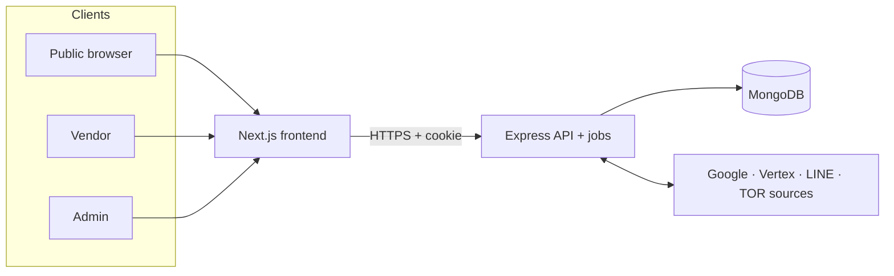
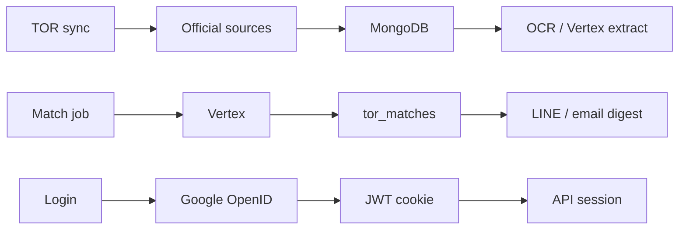
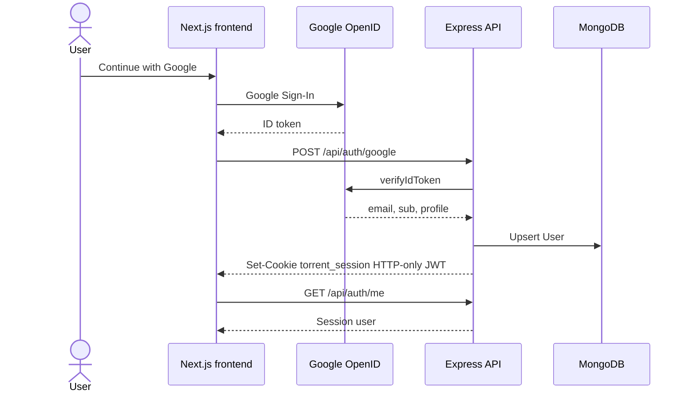
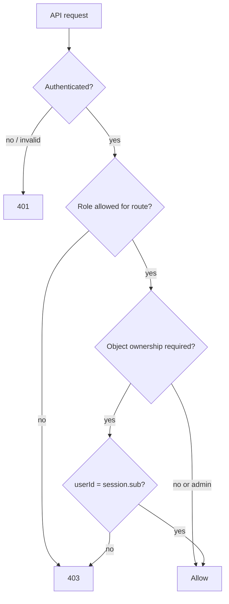
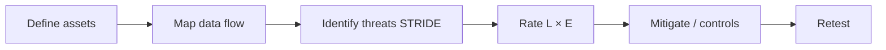
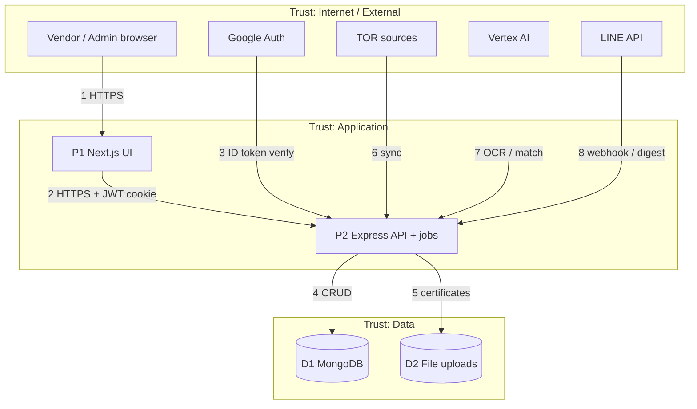
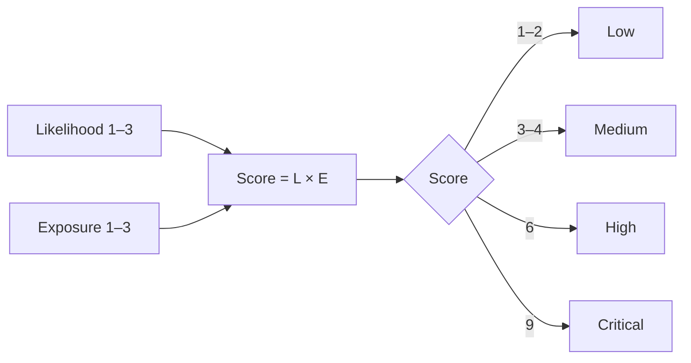
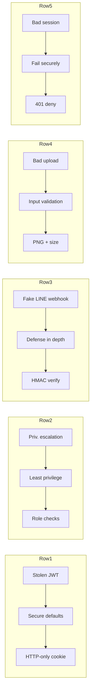
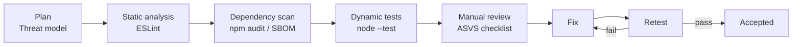

# TORRENT — Security Implementation Document

**Project:** TORRENT  
**Course:** Software Development Security  
**Institution:** Department of Computer Engineering, Kasetsart University  
**Supervisor:** Dr Sirisilp Kongsilp  
**Standard:** OWASP Application Security Verification Standard (ASVS) 5.0  
**Document date:** 22 November 2026  
**Assessment scope:** Local development / university assessment (not a public production deployment claim)

---

## 1. Application name and team members

### 1.1 Application name

**TORRENT** (also styled **Torrent**) is a web application for discovering, monitoring, and matching Thai public-sector Terms of Reference (TOR) opportunities. Vendors maintain capability profiles; the system ingests official procurement feeds, extracts TOR content, and scores vendor–TOR fit.

| Layer | Technology |
| --- | --- |
| Frontend | Next.js 16, React 19, TypeScript |
| Backend | Express 5, Mongoose |
| Database | MongoDB |
| Deploy (local) | Docker Compose (frontend, backend), external MongoDB Atlas |



### 1.2 Team members

| Name | Role |
| --- | --- |
| Jirakorn Chaitanaporn | Team member |
| Napat Kulnarong | Team member |
| Sethtatad Kijkanjanarat | Team member |
| Dr Sirisilp Kongsilp | Supervisor |

Security work was tracked in Jira project **TS** (ASVS chapter epics and implementation tasks).

---

## 2. Functional features

TORRENT provides three audiences—**public**, **vendor**, and **admin**—over a shared REST API.

### 2.1 Public features

- Browse and filter published software-related government TOR listings
- View TOR detail, budgets, departments, and category distribution
- Public monitor / budget dashboard views
- Google-based account registration and sign-in (no local password login)

### 2.2 Vendor features

- Authenticated vendor workspace
- Capability profile management (skills, projects, contact, certificates)
- PNG certificate upload and owner-restricted download
- TOR match results (`/mine`) and match feedback
- Optional LINE account linking and weekly match digest
- Optional email alerts / watchlist behaviour

### 2.3 Admin features

- User and role administration
- Vendor profile and certificate review
- TOR review / classification / integrity workflows
- Manual and scheduled sync of official sources
- Match job visibility and retry
- Audit log and sync-run visibility

### 2.4 Backend pipelines (system features)

| Pipeline | Description |
| --- | --- |
| Sync / ingest | Scheduled and manual fetch from official sources (e.g. data.go / process5, BMA, RSS) into MongoDB |
| OCR / extract | PDF text or Vertex extraction of TOR summaries and requirements |
| Matching | Async Vertex scoring of vendors against TORs; persisted `tor_matches` |
| Notifications | LINE digest and email alert delivery for linked / configured users |
| Auth session | Google OpenID ID-token verify → HTTP-only JWT session cookie |



---

## 3. Security features mapped to OWASP ASVS

Security controls were implemented and verified against **OWASP ASVS 5.0** chapters used in the course backlog (Jira labels `asvs` / `asvs-task`). The mapping below summarizes **implemented security features** and the ASVS areas they support. Detailed evidence lives in repository documents and automated tests.

### 3.1 Chapter summary

| ASVS chapter | Security features in TORRENT | Primary evidence |
| --- | --- | --- |
| **V1 Encoding & Sanitization** | Injection-safe querying via Mongoose; reject `$` / `.` operator keys; regex escaping; sanitization of untrusted text/XML | `inputSafety`, `regexSafety`, `parserSecurity` tests; validation middleware |
| **V2 Validation & Business Logic** | Schema/type checks; ObjectId validation; rate limits (anti-automation); business rules for roles and ownership | `requireOwnUserId`, certificate limits, rate limiters in `app.js` |
| **V3 Web Frontend Security** | HTTP-only / SameSite / Secure cookies; CSP and security headers; CORS allowlist (not `*`); origin separation | `securityHeaders`, CSRF/CORS tests, cookie options in `session.js` |
| **V4 API & Web Service** | Authenticated mutations; HTTP method/framing guards; structured JSON errors | `mutationAuth`, `securityHardening` tests |
| **V5 File Handling** | PNG-only certificates; size caps; structural PNG validation; owner/admin download; mode `0600` storage | `certificateUploads` tests; `certificateStorage.js` |
| **V6 Authentication** | Google OpenID (no local passwords by design); ID-token verification; disabled-account denial | `googleAuth.js`, `authService.js`, `googleAuthSecurity` tests |
| **V7 Session Management** | JWT session cookie; expiry; logout / jti revocation; sessionVersion invalidation; sliding refresh | `session.js`, `securityHardening`, mutation auth tests |
| **V8 Authorization** | Roles `public` / `vendor` / `admin`; route `requireRole`; global `requireMutationAuth` | `requireRole.js`, `requireMutationAuth.js` |
| **V9 Self-contained Tokens** | Typed session JWT (`typ`, `aud`, `jti`, `sv`); signature verification; reject wrong token types | `session.js`, token tests |
| **V10 OAuth / OIDC** | Google GIS ID token; audience bound to `GOOGLE_CLIENT_ID`; nonce/OIDC hardening where implemented | `googleAuth.js`, OIDC-related security PRs/tests |
| **V11 Cryptography** | CSPRNG secrets; documented algorithms; JWT/HMAC usage; crypto inventory | `Cryptographic.md`, crypto tests |
| **V12 Secure Communication** | HTTPS to external providers; TLS guidance for production edge | `Cryptographic.md` / V12 tasks; outbound URL controls |
| **V13 Configuration** | Env + Docker secrets via `readSecret`; no secrets in frontend bundle; CORS_ORIGIN config | `config/secrets.js`, `dockerSecrets` tests |
| **V14 Data Protection** | Data classification; minimization; `Cache-Control: no-store` on auth; owner-only sensitive APIs | `Data-Protection.md`, `dataProtection` tests |
| **V15 Secure Coding & Architecture** | Dependency remediation policy; CycloneDX SBOM; resource-availability defenses | `dependency-management.md`, `Secure-Coding-Architecture.md`, `sbom/` |
| **V16 Logging & Error Handling** | Structured security logs; audit_logs; redaction; fail-closed auth errors | `Logging.md`, logging / audit tests |

### 3.2 Representative control → ASVS requirement examples

| Implemented control | Example ASVS alignment |
| --- | --- |
| Google ID token verify + HTTP-only session cookie | V6 Authentication, V7 Session, V10 OIDC |
| `requireRole` / `requireMutationAuth` | V8 Authorization |
| Profile / certificate / match ownership checks | V8 Authorization (object-level) |
| PNG + size + PNG structure validation | V2 Validation, V5 File Handling |
| Reject body keys starting with `$` | V1 Injection Prevention (NoSQL) |
| `CORS_ORIGIN` allowlist + CSRF on mutations | V3 Origin separation, V4 API |
| `readSecret()` / `*_FILE` Docker mounts | V13 Secret Management |
| Auth rate limits, OCR batch caps, match job queue | V2 Anti-automation, V15 resource defenses |
| Security event logging (`securityLog`) + admin audit | V16 Logging |





### 3.3 Related documentation

| Document | Purpose |
| --- | --- |
| [Secure-Coding-Architecture.md](./Secure-Coding-Architecture.md) | ASVS V15.1 hub (SBOM, heavy ops) |
| [dependency-management.md](./dependency-management.md) | V15.1.1 remediation timeframes |
| [Data-Protection.md](./Data-Protection.md) | V14 classification and protections |
| [Cryptographic.md](./Cryptographic.md) | V11 crypto inventory |
| [Logging.md](./Logging.md) | V16 logging inventory |
| [Open API.md](./Open%20API.md) | API authz / CSRF behaviour |

Jira ASVS tasks under project **TS** record per-section implementation status (chapters V1–V16).

---

## 4. Threat modeling

Threat modeling for TORRENT followed a practical STRIDE-oriented process aligned with the course security deliverable.

### 4.1 Approach

| Step | Activity |
| --- | --- |
| 1. Define assets | List what must be protected |
| 2. Map data flow | Components, flows, and trust boundaries |
| 3. Identify threats | Apply STRIDE to components and boundaries |
| 4. Rate and mitigate | Likelihood × Exposure scoring; select controls |



### 4.2 Assets

- User credentials / session tokens (JWT cookies)
- Vendor profiles and personal data
- Uploaded certificates and documents
- API secrets and encryption keys
- Authentication and authorization roles
- Database records (users, tors, matches, jobs)
- LINE webhook and third-party integrations
- Admin / host account access

### 4.3 Components and trust boundaries

**Components:** Browser / Next.js frontend · Express API · MongoDB · Google Auth · Vertex AI · LINE Messaging API · External TOR sources (e-GP, BMA, data.go)

**Trust boundaries:**

1. Public internet ↔ frontend  
2. Frontend ↔ backend API  
3. Backend ↔ MongoDB  
4. Backend ↔ Google / Vertex / LINE  
5. Backend ↔ external TOR sources  
6. Authenticated user vs admin roles  

**Primary data flows:**

1. Login → Google → JWT cookie → API  
2. Vendor profile / certificates → API → MongoDB / uploads  
3. TOR sync → sources → MongoDB → OCR / Vertex extract  
4. Match job → Vertex → `tor_matches` → LINE digest  
5. Admin actions → API → DB / jobs  



### 4.4 STRIDE threats (summary)

| Category | Example threats |
| --- | --- |
| **S** Spoofing | Stolen/forged JWT; fake Google token; spoofed LINE webhook |
| **T** Tampering | Altered profiles/matches; malicious certificate uploads; sync data tampering |
| **R** Repudiation | Privileged actions without audit trail |
| **I** Information disclosure | PII/profile leak; secret exposure; over-exposed match data |
| **D** Denial of service | API/job flood; Vertex quota abuse |
| **E** Elevation of privilege | Vendor reaching admin APIs; bypass of mutation/role checks |

### 4.5 Risk rating

Risk score = **Likelihood (1–3) × Exposure (1–3)**.

| Score | Level |
| --- | --- |
| 1–2 | Low |
| 3–4 | Medium |
| 6 | High |
| 9 | Critical |

**Prioritized threats (examples):**

| Threat | L | E | Score | Level |
| --- | --- | --- | --- | --- |
| Stolen / forged JWT session | 3 | 3 | 9 | Critical |
| Fake Google identity / token replay | 3 | 3 | 9 | Critical |
| Vendor reaches admin endpoints | 3 | 3 | 9 | Critical |
| Spoofed LINE webhook | 2 | 3 | 6 | High |
| Leak PII / vendor profiles | 2 | 3 | 6 | High |
| Expose API secrets | 2 | 3 | 6 | High |
| Bypass role / mutation checks | 2 | 3 | 6 | High |



Mitigations for critical/high items include HTTP-only sessions, Google token verification, HMAC webhook checks, role and ownership enforcement, secret management, validation, rate limiting, and security logging (see §3 and §5).

---

## 5. Security principles followed in implementation

| Principle | How TORRENT applies it |
| --- | --- |
| **Least privilege** | Roles `public` / `vendor` / `admin`; vendors limited to vendor API paths; ownership checks on profiles, matches, and certificates |
| **Defense in depth** | Session auth + CSRF/Origin + CORS allowlist + LINE HMAC + security headers + rate limits |
| **Input validation** | ObjectId checks; field allow-lists; PNG-only uploads with size and structure checks; NoSQL operator-key rejection |
| **Secure defaults** | HTTP-only / SameSite cookies; Host-prefixed Secure cookies in production; deny-by-default mutations |
| **Fail securely** | Missing/invalid/disabled/revoked sessions return 401; forbidden roles return 403; never continue as authenticated on error |
| **Complete mediation** | Global `requireMutationAuth` on API writes; route-level `requireRole` / owner middleware |
| **Separation of duties / accountability** | Admin audit logs for privileged changes; structured security event logs |
| **Minimize attack surface** | No local password store (SSO only); secrets kept server-side; no analytics trackers in app source |
| **Keep it simple & document decisions** | Layered backend; ASVS evidence documents for crypto, logging, data protection, dependencies |

### 5.1 Threat → principle → implementation (examples)

| Threat | Principle | Implementation |
| --- | --- | --- |
| Stolen / forged JWT | Secure defaults | HTTP-only session cookie (`session.js`) |
| Privilege escalation | Least privilege | Role checks (`requireMutationAuth.js`) |
| Spoofed LINE webhook | Defense in depth | HMAC signature verify (`lineController.js`) |
| Malicious upload | Input validation | PNG + size checks (`certificateStorage.js`) |
| Invalid / disabled session | Fail securely | 401 deny path (`requireAuth.js`) |



---

## 6. Security test process

### 6.1 Pipeline

| Stage | Method / tool | When |
| --- | --- | --- |
| Plan | Threat model (assets, DFD, STRIDE, risk scores) | Design / before controls |
| Static analysis | ESLint (frontend CI on push/PR) | Continuous |
| Dependency review | `npm audit` / `npm outdated`; SBOM refresh | On dep change; periodic policy review |
| Dynamic / automated security tests | Node.js test runner (`node --test`) | Local and before merge |
| Manual review | Role abuse, entry-point, and ASVS checklist review | After features land |
| Fix → retest | Patch controls; re-run targeted suites | Until green |



### 6.2 Automated security-focused tests (examples)

| Area | Example test files |
| --- | --- |
| AuthN / AuthZ / CSRF | `tests/auth/mutationAuth.test.js`, `securityHardening.test.js`, `googleAuthSecurity.test.js` |
| Ownership / matches | `tests/auth/torMatchAuthorization.test.js` |
| Certificates / uploads | `tests/vendor/certificateUploads.test.js` |
| Secrets | `tests/security/dockerSecrets.test.js` |
| Input / parsers | `tests/security/inputSafety.test.js`, `parserLimits.test.js`, `regexSafety.test.js` |
| Data protection | `tests/user/dataProtection.test.js`, `tests/security/generalDataProtection.test.js` |
| Logging / audit | `tests/logging/generalLogging.test.js`, `tests/auth/auditLogProtection.test.js` |
| Availability / limits | `tests/resourceAvailability.test.js` |
| Outbound / SSRF-related | `tests/security/outboundUrl.test.js`, `torFetch.test.js`, `torDns.test.js` |

### 6.3 Example test cases

| Test case | Threat covered | Expected result |
| --- | --- | --- |
| Mutation without session | Spoofing (missing session) | 401 |
| Forged / expired JWT | Spoofing (forged token) | 401 |
| Vendor calls admin API | Elevation of privilege | 403 |
| LINE webhook bad HMAC | Spoofing (fake webhook) | 401 |
| Non-PNG / oversized certificate | Tampering / bad input | 400 / 413 |
| Missing / forged CSRF | Tampering (CSRF) | Denied |
| Disabled account with old cookie | Session reuse | 401 |
| Logout then reuse JWT | Revoked session | 401 |

### 6.4 How to run

From the repository (examples):

```bash
# Frontend lint (CI)
npm --prefix frontend run lint

# Backend security-related suites (illustrative)
cd backend && node --require module-alias/register --test \
  tests/auth/mutationAuth.test.js \
  tests/auth/securityHardening.test.js \
  tests/vendor/certificateUploads.test.js \
  tests/security/dockerSecrets.test.js \
  tests/user/dataProtection.test.js \
  tests/resourceAvailability.test.js

# Dependency audit
npm --prefix backend audit
npm --prefix frontend audit

# Regenerate SBOMs (V15.1.2 evidence)
./scripts/generate-sbom.sh
```

### 6.5 Results practice

Findings from threat modeling and testing were tracked to severity (Critical / High / Medium / Low), remediated through security hardening on the `security` integration branch, and re-checked with automated regression tests. ASVS section tasks in Jira record acceptance of each chapter area.

```mermaid
xychart-beta
  title "Vulnerabilities by severity — before vs after remediation"
  x-axis [Critical, High, Medium, Low]
  y-axis "Count" 0 --> 5
  bar [3, 4, 4, 3]
  bar [0, 0, 0, 0]
```



*Chart note:* Before counts follow the prioritized STRIDE risk table in §4.5 (grouped by level). After counts reflect mitigated items closed through security hardening and regression tests on the `security` branch.

---

## 7. References (repository)

| Path | Content |
| --- | --- |
| `document/design.md` | System design, architecture, resource controls |
| `document/Security-Implementation.md` | This document |
| `document/Secure-Coding-Architecture.md` | ASVS V15.1 |
| `document/dependency-management.md` | Dependency update / remediation policy |
| `document/Data-Protection.md` | Data classification and protection |
| `document/Cryptographic.md` | Cryptographic inventory |
| `document/Logging.md` | Logging inventory |
| `document/sbom/` | CycloneDX SBOMs |
| `backend/src/middleware/` | AuthZ, CSRF, uploads, headers |
| `backend/tests/` | Automated verification |

---

*End of document.*
