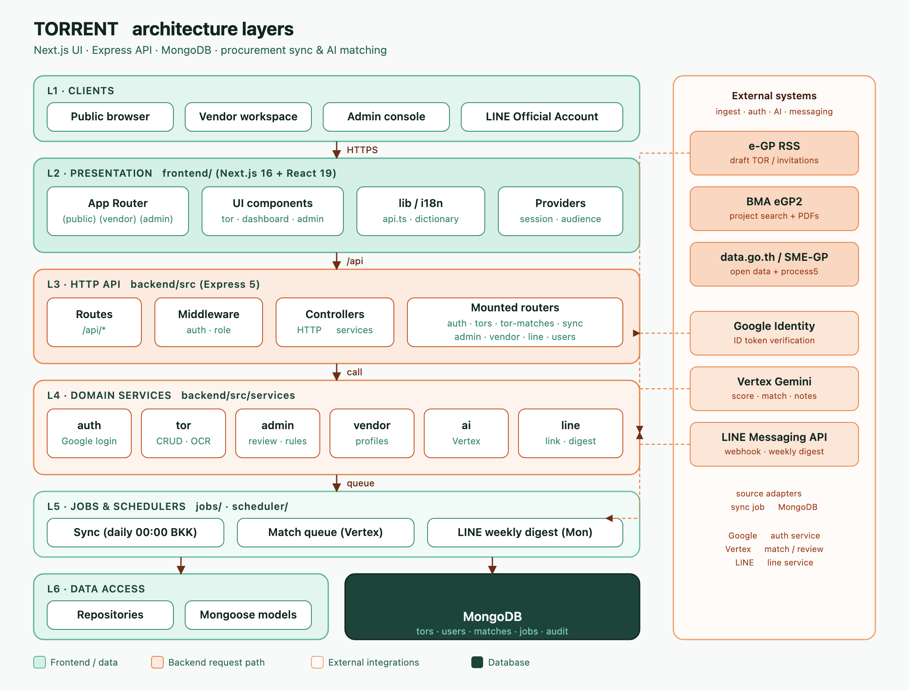
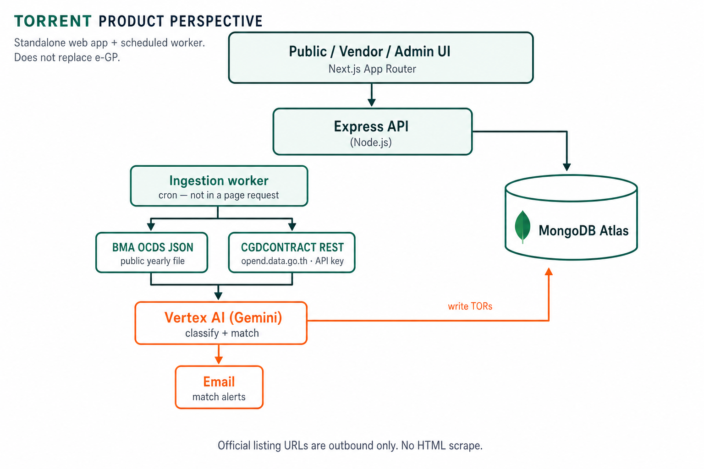

# TORRENT — Software Design Document

**Version:** 1.0<br>
**Reference printed:** November 13, 2026<br>
**Markdown synchronized:** November 22, 2026<br>
**Team:** Jirakorn Chaitanaporn, Napat Kulnarong, Sethtatad Kijkanjanarat<br>
**Supervisor:** Dr Sirisilp Kongsilp<br>
**Department:** Computer Engineering, Kasetsart University

**Reference:** [Torrent — Design Document tab](https://docs.google.com/document/d/1ixF1286PtkrrpFZl8BgFzwK0TIfdrbNHOTHl38imJ3M/edit?tab=t.xt2s53oymefy). Sections 1–15 follow that reference. The resource-availability controls and local implementation supplements below retain repository-specific material. Hosting candidates in the reference are design proposals; this project's current assessment scope is local-only.

Embedded source diagrams are linked to their Google Doc sections because the connector denied image export. Existing repository diagrams remain available in the local supplements.

## Revision history

| Version | Primary author | Description | Date completed |
| --- | --- | --- | --- |
| 1.0 | Jirakorn Chaitanaporn, Napat Kulnarong, Sethtatad Kijkanjanarat | Initial release | Not specified in the reference revision table |

## 1. Introduction

### 1.1 Purpose

This Software Design Document defines the internal design of Torrent so other developers can understand how the system is structured, how components interact, how data is stored, and how major pipelines (ingestion, TOR extraction, matching) work.

### 1.2 Scope

In scope

- Public monitor and budget dashboard for software-related government TORs
- Vendor accounts, capability profiles, matching, and notifications (LINE)
- Admin review, sync triggers, and source/ops visibility
- Scheduled ingestion from official APIs (no HTML scrape as primary ingress)
- TOR PDF extraction (text layer / Vertex) and vendor–TOR scoring (Vertex)
- Frontend (Next.js), backend (Express), MongoDB, and in-process jobs

Out of scope

- Submitting bids or collecting bid prices on TORRENT
- Replacing e-GP as system of record
- Microservices / service mesh
- Playwright / HTML scraping of agency websites as ingestion

### 1.3 Definitions and Acronyms

| Term | Definition |
| --- | --- |
| TOR | Terms of Reference / procurement package for a project |
| refId | Stable external identifier used for upserts (e.g. e-GP project id) |
| e-GP | Thai electronic government procurement |
| process5 | e-GP surface used to verify project details and document links |
| data.go | Open data portal used for discovery of government contracts |
| OCDS | Open Contracting Data Standard |
| Vertex | Google Cloud Vertex AI (Gemini) for extract / classify / match |
| Modular monolith | Single API deployable with internal modules and in-process jobs |
| OCR / extract | Pulling summary, requirements, skills, deadline from a TOR PDF |
| SDD | Software Design Document |
| SRS | Software Requirements Specification |

## 2. System Overview

### 2.1 System Description

TORRENT is a reversed job board and public software-TOR monitor. It:

- Ingests official procurement feeds on a schedule
- Normalizes and deduplicates into MongoDB tors
- Extracts requirements from TOR PDFs when available
- Classifies / reviews software relevance
- Matches vendor profiles via Vertex and stores scores
- Exposes public, vendor, and admin UIs over a REST API

### 2.2 Design Goals

| Goal | How it shows up in design |
| --- | --- |
| Maintainability | Layered backend (routes → controllers → services → repositories → models); source adapters isolated per feed |
| Traceability | Every TOR keeps source lineage (source, sources[], official URLs) |
| Honesty of lifecycle | Do not invent draft state for award-only rows; discovered when PDF missing |
| Security of secrets | API keys / Vertex / DB URI only in server env — never in the Next.js client bundle |
| Resilience of jobs | Matching can resume after backend restart instead of starting over; syncing the same TORs again updates the existing row instead of creating duplicate |
| Fair vendor discovery | Capability fit scoring + optional certificate bonuses; apply stays on official sites |

### 2.3 Architecture Summary

Style: Modular monolith + scheduled in-process workers.

| Piece | Role |
| --- | --- |
| Next.js frontend | UI for public / vendor / admin |
| Express backend | REST API + sync / OCR / match / LINE digest jobs |
| MongoDB | Persistence |
| External systems | data.go / process5 / BMA / RSS, Google Identity, Vertex, LINE |

Not microservices: jobs share the same process and repositories as the HTTP API.

### 2.4 System Context Diagram

[2.4 System Context Diagram — view in the Google Doc](https://docs.google.com/document/d/1ixF1286PtkrrpFZl8BgFzwK0TIfdrbNHOTHl38imJ3M/edit?tab=t.xt2s53oymefy#heading=h.t60g8gvq6l9v)

## 3. Use Case Model

### 3.1 Actors

| Actor | Type | Primary goals |
| --- | --- | --- |
| Public visitor | Person | Browse TORs, monitor, budget dashboard — no login |
| Vendor | Person | Profile, matches, fit reasons, saved items, LINE digest |
| Admin | Person | Sync, classification review, user/TOR moderation |
| Ingestion worker | System | Scheduled / manual sync |
| Matcher worker | System | TOR-centric Vertex matching queue |
| Google / Vertex / LINE / official APIs | Systems | Auth, AI, messaging, data ingress |

### 3.2 Use Case Catalogue & Diagram

| ID | Use case | Primary | Summary |
| --- | --- | --- | --- |
| UC-1 | Browse / search / open TOR | Public, Vendor | List, filter, detail; official deep-link |
| UC-2 | Receive match notification | Vendor | Match stored; LINE/digest when enabled |
| UC-3 | View budget dashboard | Anyone | Medians, compare, historical table |
| UC-4 | Manage profile & prefs | Vendor | Capabilities, certificates, digest prefs |
| UC-5 | Review classification | Admin | Approve / reject / hide + audit |
| UC-6 | Register / log in | Vendor, Admin | Google ID token → HTTP-only session |
| UC-7 | View vendor TOR fit | Vendor | Score, reasons, gaps |
| UC-8 | Watchlist / saved | Vendor | Save TOR interest |
| UC-9 | Scheduled ingest | System | Fetch → adapt → upsert → OCR → merge → enqueue match |
| UC-10 | Monitor source health | Admin | Probe / sync visibility |
| UC-11 | Flag inaccuracy | Public / Agency | Report bad data → admin |
| UC-12 | Public home & monitor | Public | Landing + KPIs + latest |
| UC-13 | Moderate vendor account | Admin | Disable / certificate review |

[3.2 Use Case Catalogue & Diagram — view in the Google Doc](https://docs.google.com/document/d/1ixF1286PtkrrpFZl8BgFzwK0TIfdrbNHOTHl38imJ3M/edit?tab=t.xt2s53oymefy#heading=h.t7wl2j9yyldz)

### 3.3 UC-10 Happy path (ingest)

- Cron at 00:00 Asia/Bangkok (optional startup fetch via FETCH_ON_STARTUP)
- Active source dataGoProcess5 fetches and adapts rows
- Upsert by refId
- OCR enrich for downloadable TOR PDFs
- Cross-source merge
- Enqueue match jobs
- Score new rows for review thresholds when configured

## 4. Domain Model

### 4.1 Core Concepts

| Concept | Meaning |
| --- | --- |
| TOR | Normalized opportunity document shown in UI |
| refId | External stable id; sync upsert key |
| Source appearance | One feed’s view of a project (sources[] after merge) |
| OCR result | Embedded extraction payload on the TOR |
| Vendor profile | Capabilities used for matching |
| TOR match | Stored score for (userId, torId) |
| Match job | Queue each TOR and match against users |
| Audit log | Human ops trail |
| Admin settings | Keyword / threshold config for classification |

### 4.2 Conceptual Relationships

[4.2 Conceptual Relationships — view in the Google Doc](https://docs.google.com/document/d/1ixF1286PtkrrpFZl8BgFzwK0TIfdrbNHOTHl38imJ3M/edit?tab=t.xt2s53oymefy#heading=h.byn3rfkkwgj8)

### 4.3 Logical Bounded Contexts (same deployable)

| Context | Owns |
| --- | --- |
| Ingestion | Fetchers, adapters, sync, merge |
| Extraction | PDF download, text/OCR, Vertex extract |
| Review / admin | Classification, hide, audit, settings |
| Matching | Queue, Vertex match, thresholds |
| Identity | Google verify, JWT cookie, roles |
| Vendor | Profiles, certificate files |
| Presentation | Next.js + lib/api.ts mapping |
| Messaging | LINE link + weekly digest |

## 5. Architectural Design

### 5.1 System architecture Diagram

[5.1 System architecture Diagram — view in the Google Doc](https://docs.google.com/document/d/1ixF1286PtkrrpFZl8BgFzwK0TIfdrbNHOTHl38imJ3M/edit?tab=t.xt2s53oymefy#heading=h.at59oq2hyltk)

### 5.2 Component Breakdown

| Component | Responsibilities | Interactions |
| --- | --- | --- |
| Next.js app | Render pages; call REST; session provider; bilingual UI | Express /api/* |
| Express HTTP layer | AuthZ, validation glue, JSON/multipart responses | Services |
| TOR / sync services | Ingest, normalize, OCR, merge, CRUD | Repositories, external APIs, Vertex |
| Matching services / job | Score vendors vs TOR; durable queue | Vertex, tor_matches, jobs collection |
| Auth service | Verify Google token; issue cookie JWT | Google, users |
| Vendor service | Profile + certificate storage | vendor_profiles, upload/ |
| Admin service | Review queue, settings, audit, bulk TOR ops | Mongo collections |
| LINE service | Webhook, link codes, weekly digest | LINE API, users, matches |
| MongoDB | Persist all domain collections | Repositories |

### 5.3 Technology Stack

| Layer | Choice |
| --- | --- |
| Frontend | Next.js 16, React.js 19, TypeScript, Tailwind |
| Backend | Node.js, Express.js 5, Mongoose |
| Database | MongoDB 8 (will be switched to Mongo Atlas in deployment) |
| AI | Vertex AI Gemini |
| Auth | Google Identity + HTTP-only JWT cookie |
| Messaging | LINE Messaging API, Gmail |
| Local runtime | Docker Compose (frontend, backend) with MongoDB Atlas |

### 5.4 Data Flow and Control Flow

Primary ingest + extract + match:

[5.4 Data Flow and Control Flow — view in the Google Doc](https://docs.google.com/document/d/1ixF1286PtkrrpFZl8BgFzwK0TIfdrbNHOTHl38imJ3M/edit?tab=t.xt2s53oymefy#heading=h.mkfwgtkzttez)

## 6. Layer Design

| Layer | Location | Rule |
| --- | --- | --- |
| L1 Clients | Browser, vendor workspace, admin, LINE | HTTPS only into FE/API |
| L2 Visualization | frontend/ | No source-specific parsing; map via lib/api.ts |
| L3 HTTP API | backend/src/routes, controllers, middleware | Controllers call services only |
| L4 Domain services | backend/src/services/* | Own workflows |
| L5 Jobs | backend/src/jobs, scheduler | Sync 00:00 BKK; ingest TORs;  match queue; LINE Monday digest |
| L6 Data access | repositories, models | All DB queries in repositories |
| L7 Persistence | MongoDB | Collections listed in §9 |

https://drive.google.com/file/d/1yh_ex4VEBdWsiu_e6mPSK1XS_6KwqVLL/view?usp=sharing

[6. Layer Design — view in the Google Doc](https://docs.google.com/document/d/1ixF1286PtkrrpFZl8BgFzwK0TIfdrbNHOTHl38imJ3M/edit?tab=t.xt2s53oymefy#heading=h.n086ll7zw9f4)

## 7. Detailed Design

### 7.1 Frontend (Next.js)

| Aspect | Detail |
| --- | --- |
| Responsibility | Public monitor/dashboard, vendor workspace, admin UI, i18n, session |
| Key modules | app/(public), (auth), (vendor), (admin); lib/api.ts; types/tor.ts; providers |
| Interfaces | Express via api() / apiUrl() with credentials: "include" |
| Data / state | UI Tor mapped from backend; providers for session, locale, saved, notifications, audience; TanStack Query where used |
| Notes | Route-group folders (…) do not appear in URLs |

### 7.2 HTTP API / controllers

| Aspect | Detail |
| --- | --- |
| Responsibility | Parse HTTP, enforce auth/role, call services, map errors to status codes |
| Key modules | routes/, controllers/, middleware/requireAuth.js, requireRole.js |
| Inputs | JSON, query/params, multipart (profile + certificate files), cookies |
| Outputs | JSON; protected certificate binaries; LINE webhook ACK 200 fast |
| Errors / state | Exceptions → 4xx/5xx + { message } (optional code); HTTP is stateless; identity in signed cookie |

### 7.3 Ingestion & TOR services

| Aspect | Detail |
| --- | --- |
| Responsibility | Fetch feeds, normalize TOR, upsert, merge duplicates, trigger OCR/match |
| Key modules | jobs/syncAPI.js, services/tor/api/&lt;source>/{fetch,adapter}.js, mergeDuplicateTors.js |
| Sources | Active default: dataGoProcess5. Manual: process3Process5, dataGo, bmaEgp2, egpRss, … |
| Logic | Adapter → common shape; upsert by refId (create / change / unchanged); merge records conflicts |
| Notes | Keyword category helpers live in shared TOR utils |

### 7.4 Extraction (OCR) module

| Aspect | Detail |
| --- | --- |
| Responsibility | Download TOR PDF/ZIP; extract summary, requirements, skills, deadline |
| Key modules | ocrEgp.js, ocrBmaPlans.js, extractPlanPdf.js, readPdfText.js |
| Inputs / outputs | In: documentUrl on candidates. Out: embedded tor.ocr (see §9) |
| Logic | Text layer → Vertex structured JSON; else PDF inline OCR |
| State / caps | ocr.status, summaryVersion; re-run on URL/version change; OCR_MAX_PER_SYNC |
| Notes | requirementItems categories: technical · delivery · compliance · team · other |

### 7.5 Matching module

| Aspect | Detail |
| --- | --- |
| Responsibility | TOR-centric queue; score vendors; persist matches above threshold |
| Key modules | jobs/matchTors.js, matchWithVertex.js, TorMatchJob model |
| Score policy | 30 budget-fit + 70 requirements-fit; certificate bonuses capped; final ≤ 100; keep if ≥ VERTEX_MATCH_MIN_PERCENT |
| State | Job pending · running · waiting · complete with cursor, lease, retryAt |
| Errors | Vertex quota/rate limit → waiting + retry; cursor preserved across restarts |

### 7.6 Auth & identity

| Aspect | Detail |
| --- | --- |
| Responsibility | Google login, session cookie, /me, logout |
| Key modules | authService, googleAuth, session, requireAuth, requireRole |
| Roles | public · vendor · admin |
| State | JWT in HTTP-only cookie; users row (optional LINE link fields) |

### 7.7 Vendor profiles & certificates

| Aspect | Detail |
| --- | --- |
| Responsibility | Profile CRUD; store relative PNG paths; serve files to owner/admin |
| Key modules | vendorProfileService, certificateStorage, certificateUpload middleware |
| Inputs | JSON or multipart: securityCertificates · aiCertificates · otherCertificates |
| Validation | PNG-only; size/dimension caps; ≤ 5 images per category |
| Storage | backend/upload/ (Compose bind-mount) |

### 7.8 Admin & review

| Aspect | Detail |
| --- | --- |
| Responsibility | Overview, review queue, rescore, TOR edits/PDF, users, certificates, settings, audit, match retry |
| Key modules | adminService, /api/admin/* routers |
| Auth | Admin role required |

### 7.9 LINE messaging

| Aspect | Detail |
| --- | --- |
| Responsibility | Webhook, account link/unlink, digest preference, weekly digest job |
| Key modules | line routes/controllers/services, lineWeeklyDigest job |
| Security | HMAC x-line-signature over raw body before handling events |

## 8. API Design

### 8.1 Conventions

| Topic | Rule |
| --- | --- |
| Style | REST + JSON (multipart for certificates) |
| Base | http://localhost:5175/api (Compose SSR uses http://backend:5175/api) |
| Auth | HTTP-only JWT cookie; CORS allowlist via CORS_ORIGIN |
| Client | frontend/src/lib/api.ts |
| Caching | Listings/dashboard often cache: "no-store" |

### 8.2 Endpoint Groups

| Prefix | Auth | Purpose |
| --- | --- | --- |
| /api/auth | mixed | Google login, me, logout |
| /api/tors | public read; admin write | TOR list/detail + dashboard aggregates |
| /api/tor-matches | vendor for /mine | Matches CRUD / ensure / pending |
| /api/vendor-profiles | owner/admin for mutating | Profiles + certificates |
| /api/sync/* | admin | Manual / full sync and OCR triggers |
| /api/admin/* | admin | Ops, review, settings, audit |
| /api/line | webhook HMAC; vendor/admin for link APIs | LINE integration |
| /api/users, /api/user-bios | as routed | Account / bio helpers |
| /, /api/hello | public | Liveness |

### 8.3 Representative Contracts

Google login — POST /api/auth/google

- Input: Google credential / ID token
- Output: session cookie + user payload

Vendor matches — GET /api/tor-matches/mine

- Input: session cookie
- Output: match rows (matchPercent, matchReason, torId, …)

Sync (admin) — POST /api/sync/data-go-process5

- Output: sync summary (fetched/created/updated, OCR counts, errors)

### 8.4 API overview diagram

[8.4 API overview diagram — view in the Google Doc](https://docs.google.com/document/d/1ixF1286PtkrrpFZl8BgFzwK0TIfdrbNHOTHl38imJ3M/edit?tab=t.xt2s53oymefy#heading=h.8w3ihtxnnpqf)

## 9 . Database Design

### 9.1 ER / Schema Diagram

[9.1 ER / Schema Diagram — view in the Google Doc](https://docs.google.com/document/d/1ixF1286PtkrrpFZl8BgFzwK0TIfdrbNHOTHl38imJ3M/edit?tab=t.xt2s53oymefy#heading=h.z2sa50ddbp9f)

### 9.2 Collections

| Collection | Model | Purpose / key fields |
| --- | --- | --- |
| users | User.js | email (unique), role, googleId, lineUserId, disabled |
| vendor_profiles | VendorProfile.js | userId (unique), skills, pastProjects, certificate path arrays |
| tors | TOR.js | refId, title, status, source, budget/dates, review, integrity, sources[], merge, ocr{} |
| tor_matches | TORMatch.js | unique (userId, torId), matchPercent, matchReason, dismissedAt |
| tor_match_jobs_by_tor | TorMatchJob.js | unique torId, status, cursor, lease, retry |
| audit_logs | AuditLog.js | action, targetType/Id, actor*, changes[] |
| sync_runs | SyncRun.js | sourceKey, status, run metrics |
| admin_settings | AdminSettings.js | keyword rules, thresholds |
| userbios | UserBio.js | public bio (if used) |

### 9.3 Indexes (selected)

| Collection | Index | Kind | Why |
| --- | --- | --- | --- |
| users | email | unique | Login / account lookup |
| users | googleId | unique, sparse | Google identity |
| users | lineUserId | unique, sparse | LINE link |
| vendor_profiles | userId | unique | 1:1 with user |
| tors | refId | indexed | Sync upsert / dedupe |
| tors | hidden, reviewStatus, integrityStatus, mergeStatus | indexed | List / admin filters |
| tor_matches | (userId, torId) | unique compound | One score per vendor–TOR pair |
| tor_match_jobs_by_tor | torId | unique | One job per TOR |
| tor_match_jobs_by_tor | status | indexed | Worker dequeue |
| audit_logs | createdAt | descending | Recent audit trail |
| audit_logs | action, targetType, targetId | indexed | Filter by event / target |

## 10. External Interfaces

### 10.1 External APIs / Integrations

| Integration | Direction | Use |
| --- | --- | --- |
| data.go + process5 | Out | Primary discovery + document verification |
| BMA e-GP2 | Out | Manual/alternate city source + plans OCR |
| e-GP RSS / process3 path | Out | Manual alternate draft/announce path |
| Google Identity | Out | ID token verification |
| Vertex Gemini | Out | Extract, score/match, assist review |
| LINE Messaging | In/Out | Webhook + push digest |

### 10.2 Network Protocols / Communication

- Browser ↔ API: HTTPS (local HTTP), REST JSON, cookie session
- Workers ↔ government APIs: HTTPS GET/POST as per source
- LINE webhook: HTTPS POST + HMAC signature
- Not used: GraphQL, gRPC, WebSockets (current design)

## 11. Security Considerations

### 11.1 Authentication

- Google ID token verified server-side
- Session = signed JWT in HTTP-only cookie
- LINE webhook authenticated via channel secret HMAC

### 11.2 Authorization

- Roles: public, vendor, admin
- Middleware: requireAuth, requireRole, profile ownership checks
- Certificate download restricted to owner/admin
- Sync and admin routers require admin

### 11.3 Data Protection

- Secrets only in environment variables
- CORS origin allowlist + credentials
- Certificate uploads: PNG-only validation (signature, chunks, size, dimensions)
- OCR download host allowlist (*.gprocurement.go.th, HTTPS)
- Mongoose parameterized queries (no string-concat query building)
- Vendor capability detail private except intentionally public showcase fields

### 11.4 Compliance

- No HIPAA scope
- Personal data: Google profile fields, vendor contact, LINE user id — minimize retention; treat as student/course system with secure defaults
- Security requirements tracked against OWASP ASVS

### 11.5 Threat Notes (lightweight)

| Threat | Mitigation |
| --- | --- |
| SSRF via document URL | Host/protocol allowlist on OCR fetch |
| Session theft | HTTP-only cookie; HTTPS in deploy |
| Injection | Mongoose APIs; no eval of TOR text as code (prompt treats TOR as data) |
| Upload abuse | PNG validation + size/count caps |
| LINE spoofing | Signature verification on raw body |

## 12. Performance and Scalability

### 12.1 Expected Load

Course / prototype scale: low concurrent users; ingestion bounded by:

- Source page size / retries in constants
- EGP_MAX_PROJECTS_PER_SYNC (and similar caps)
- OCR_MAX_PER_SYNC
- Vertex rate limits (match jobs wait/retry)

Exact RPS targets are not fixed yet.

### 12.2 Caching Strategy

- No shared Redis cache in current design
- Next.js: intentional no-store on TOR dashboard/list fetches so sync is visible
- Browser/providers may keep saved TOR ids / prefs in localStorage

### 12.3 Database Optimization

- Indexes on refId, review/integrity/merge flags, match pair uniqueness, job status
- Upsert-by-refId avoids duplicate growth
- OCR skip when same fileUrl + summaryVersion already ok

## 13. Deployment architecture

### 13.1 Environments

| Environment | How |
| --- | --- |
| Local npm | Frontend :3000, backend :5175, MongoDB Atlas via secret file |
| Local Compose | docker-compose.yml — frontend/backend; external MongoDB Atlas |
| Production | Evolving (proposal mentioned Vercel for FE; API/worker separate). Details TBD. |

### 13.2 CI/CD Pipeline

Current repo CI: GitHub Actions ESLint workflow (.github/workflows/eslint.yml) (install all dependency need in Ubuntu environment -> run ESlint test).

CD: The full deploy pipeline (build → staging → prod) is not fully specified in-repo yet.

### 13.3 Infrastructure Diagram (local Compose)

[13.3 Infrastructure Diagram (local Compose) — view in the Google Doc](https://docs.google.com/document/d/1ixF1286PtkrrpFZl8BgFzwK0TIfdrbNHOTHl38imJ3M/edit?tab=t.xt2s53oymefy#heading=h.pbz3i5k099ov)

### 13.4 Cloud / Hosting

- AI: GCP Vertex
- DB: MongoDB Atlas, using `backend/.secrets/mongo_uri`
- Frontend hosting candidate: Vercel (proposal)
- Backend/worker: container or VM — finalize with team

### 13.5 Containerization

- Dockerfiles for frontend/backend; Compose orchestration
- Bind mounts for live code; anonymous volumes for node_modules
- Backend upload directory preserved via host bind in Compose workflow

## 14. Testing Strategy

### 14.1 Unit / Module tests

Backend Node test files under backend/tests/, including:

- sync / dataGoProcess5 / process3Process5
- OCR extract
- merge duplicates
- match / Vertex scoring helpers
- certificate uploads
- admin / category / budget aggregates

Run examples are documented in README for certificate tests; other suites via Node test runner with module-alias as used in-repo.

### 14.2 Integration Testing

- Certificate upload tests mock DB and use temp upload dir
- Sync/OCR tests exercise adapters and persistence paths with fixtures/mocks as implemented

### 14.3 End-to-end Testing

No dedicated E2E framework locked in this document yet (Playwright for product UI is optional later). Manual Compose smoke: FE load, /api/hello, admin sync, vendor login.

### 14.4 Quality Metrics

- ESLint on CI for frontend/workflow as configured
- Formal coverage % target: not mandated yet
- Prefer tests around money parsing, merge conflicts, OCR normalization, and match threshold math — high-regression areas

## 15. Appendices

### 15.1 How to read the code (onboarding)

Read in this order:

- docker-compose.yml
- backend/src/server.js, app.js
- backend/src/jobs/syncAPI.js
- backend/src/services/tor/ocr/*
- backend/src/jobs/matchTors.js
- frontend/src/lib/api.ts
- frontend/src/app/(public)/dashboard and (vendor)/app/*

### 15.2 How to run the project

Prerequisites: Docker Desktop (or Docker Engine + Compose v2.30+). Host Node.js is optional if you use Compose only. MongoDB is hosted in Atlas.

#### First time

- Clone the repo and open a terminal at the repository root.
- Create env from the example and fill signing secrets and API settings:

```bash
cp backend/.env.example backend/.env
```

- Put the complete Atlas `mongodb+srv://` URI in `backend/.secrets/mongo_uri`
  with the database user's URL-encoded password. Both host npm and Docker read
  this same file; Docker mounts it at `/run/secrets/mongo_uri`. No raw database
  URI is loaded from `.env`, and setup preserves the URI file. The application
  uses database `Torrent`. Allow the backend's outbound IP in Atlas Network Access.

- Prepare Docker secrets and start the stack:

```bash
./process.sh
```

- Open:
  - Frontend: http://localhost:3000
  - Backend: http://localhost:5175 (GET /api/hello for a quick check)
- Optional: follow logs with docker compose logs -f.

#### Next time (already configured)

| Goal | Command |
| --- | --- |
| Start / rebuild full stack (also refreshes secrets from .env) | ./process.sh |
| Refresh secrets only (no restart) | ./process.sh secrets |
| Recreate backend only after .env change | ./process.sh up backend |
| Stop stack (keep DB volume) | docker compose down |
| Stop and wipe local DB volume | docker compose down -v |

After .env edits that affect secrets, prefer ./process.sh or ./process.sh up backend so backend/.secrets/ stays in sync.

### 15.3 System screenshots

Paste UI captures into Google Docs under each slot (or replace the tags with images). Keep captions short.

| # | Screen | Audience | What to show |
| --- | --- | --- | --- |
| 1 | Home / landing | Public | Brand, value prop, entry to monitor / listings |
| 2 | Public monitor | Public | KPIs, latest listings, integrity highlights |
| 3 | TOR browse / list | Public, Vendor | Filters + listing cards |
| 4 | TOR detail | Public, Vendor | Summary, requirements, official link, integrity |
| 5 | Budget dashboard | Public, Vendor | Category medians / compare charts |
| 6 | Vendor matches | Vendor | Match % + reasons inbox |
| 7 | Vendor profile | Vendor | Capabilities / certificates form |
| 8 | Admin review | Admin | Classification queue / TOR review |

---

## Local implementation supplements

These repository notes supplement the November 13 reference. They retain implementation detail and security work added locally.

### Current implementation notes

- Secret provisioning and rotation use backend-only file mounts in Compose, as described in [Cryptographic.md](Cryptographic.md) and [commands.md](commands.md#secret-setup-and-rotation). The reference's environment-variable wording is not a claim that secrets belong in frontend bundles.
- Current alert emails use Resend; the reference's Gmail label is not the implemented email transport.
- The reference lists `/api/user-bios` and `UserBio.js`; the standalone user-bio route/service was removed from the current backend. Consult [Open API.md](Open%20API.md) for current endpoint contracts.
- Local frontend/API HTTP does not establish browser HTTPS enforcement. The current database configuration targets Atlas through its URI secret; verify live connectivity and provider controls separately. Vercel hosting remains proposed.
- Algorithm selection, strict session verification, e-GP library compatibility and retry-stable email hashes are documented in [Cryptographic.md](Cryptographic.md) and their regression tests.

### Existing repository diagrams

The images below are retained local implementation artifacts, not claimed to be exact exports of every embedded Google Doc diagram.





### Matching score policy (retained)

Implemented in match/Vertex services (see README):

- **30** points: budget vs team size / past project budgets<br>
- **70** points: requirements fit (Tier 1 coverage & past projects, Tier 2 skills, Tier 3 other)<br>
- Certificate bonuses capped (Security 2 + AI 2 + Other 3 ≤ 7) inside overall bonus ceiling; final ≤ **100**<br>
- Persist only if ≥ VERTEX_MATCH_MIN_PERCENT


### Detailed TOR extraction sequence (retained)

Owner: Chirew (per Tai: **only this sequence is required**).

#### Scope

End-to-end path used by the primary ingest: **data.go discovery → process5 verification → PDF/ZIP download → Vertex/text extract → save ocr → enqueue matching**.

#### Participants

Scheduler · syncAPI · dataGoProcess5.fetch · adapter · torRepository · ocrEgp · extractPlanPdf · Vertex · matchTors

#### Sequence (textual)

```text
Scheduler                syncAPI              Sources                 Mongo              OCR/Vertex           Matcher
   |                        |                    |                      |                    |                    |
   |-- daily / manual ----->|                    |                      |                    |                    |
   |                        |-- fetch rows ----->|                      |                    |                    |
   |                        |<-- dataGo+p5 ------|                      |                    |                    |
   |                        |-- adapt()          |                      |                    |                    |
   |                        |-- saveChanged --------------------------->|                    |                    |
   |                        |-- enrich(candidates)----------------------------------------->|                    |
   |                        |                    |                      |  download PDF/ZIP  |                    |
   |                        |                    |                      |  text layer?       |                    |
   |                        |                    |                      |    yes → structure w/ Vertex JSON       |
   |                        |                    |                      |    no  → scan PDF parts → Vertex OCR    |
   |                        |                    |                      |  normalize requirementItems            |
   |                        |-- saveOcr -------------------------------->|                    |                    |
   |                        |-- mergeByRefIds -------------------------->|                    |                    |
   |                        |-- enqueueTors(ids) --------------------------------------------------------------->|
   |                        |<-- sync summary ---|                      |                    |                    |
```

#### Diagram placeholder

```
<diagram:sequence-tor-extraction>
  UML sequence for the flow in §9.3.
  Highlight:
    1) Only https://*.gprocurement.go.th document URLs accepted
    2) ZIP prefer tor_*.pdf over Attach_TOR scans
    3) OCR_ENABLED=false skips extract
    4) OCR_MAX_PER_SYNC caps work per run
    5) SUMMARY_VERSION bump forces re-extract
    6) Matching runs async after enqueue (not inside HTTP request path for vendors)
</diagram:sequence-tor-extraction>
```

#### Extraction internals (extractPlanPdf)

1. If PDF has a usable text layer → send text + schema prompt to Vertex (generateStructured).<br>
2. Else → send PDF bytes as inline part (generateFromParts) — true OCR path.<br>
3. Model must return JSON: summaryTh, summaryEn, requirementItems[] (technical|delivery|compliance|team|other), deadline, skills.<br>
4. Normalize → flat requirements / requirementsEn for legacy consumers.<br>
5. Persist under tor.ocr with status, method, fileUrl, summaryVersion, timestamps / error.

Projects without a downloadable TOR stay `discovered` and are **not** treated as match-ready rich records.


## Resource availability controls

Reviewed 2026-11-22 for the local single-backend Compose architecture. The
resource-heavy operations and implemented defenses below provide evidence for
[ASVS V15.2.2](https://github.com/OWASP/ASVS/blob/v5.0.0/5.0/en/0x24-V15-Secure-Coding-and-Architecture.md).
Limits protect valid work by rejecting excess input, limiting batch work, and
releasing resources after failure. They do not establish capacity under every
workload or eliminate denial-of-service risk.

| Resource-heavy operation | Implemented strategy and evidence |
| --- | --- |
| Auth/CSRF requests and admin mutations | Per-client fixed-window throttling; excess requests receive HTTP 429 and Retry-After before downstream work. `app.js` defaults: CSRF 60/minute, Google auth 20/15 minutes, admin writes 120/minute. The focused availability test checks burst rejection, client isolation and window recovery. These limiters are process-local and are not a global concurrency cap. |
| Certificate upload buffering/parsing | `certificateUpload.js` rejects declared or streamed bodies beyond the aggregate limit; up to five 5 MiB images per category (three categories) plus 1 MiB profile budget, 76 MiB aggregate. Tests check rejection before reading an oversized declared body; certificate/parser suites cover other format and size checks. Concurrent requests can still multiply the aggregate memory cost. |
| Feed/text/XML processing | `boundedText.js` caps feed bytes and decoded text at 5 MiB; XML parsing also bounds nesting/elements and rejects DTD/entities. The focused test checks stream cancellation and successful subsequent reads; `parserLimits.test.js` and `regexSafety.test.js` supply parsing/CPU-bound regression evidence. |
| e-GP OCR batches | `ocrEgp.js` processes candidates sequentially and limits them with `OCR_MAX_PER_SYNC` (default 27). A failed extraction is recorded without preventing the next candidate from running. The focused test verifies a two-item budget across eight candidates, serial downloads and recovery from a malformed document. This bounds one invocation, not all overlapping invocations. |
| PDF text extraction | `readPdfText.js` destroys the parser in `finally` on success or failure; focused tests verify both cleanup paths. This is not a hard CPU or wall-clock limit for local PDF parsing. |
| Vertex AI requests | `vertexClient.js` supplies an AbortSignal with a default 15-second deadline; OCR callers default to 90 seconds and matching callers have their own timeout. The focused test drives the actual timer callback, verifies the signal abort, TIMEOUT mapping, timer cleanup and a later successful request. Cancellation relies on the SDK honoring the signal; a provider mock is used, not a live capacity test. |
| Scheduled ingestion | `syncScheduler.js` schedules midnight Asia/Bangkok with `noOverlap: true`; `sync.test.js` checks scheduling configuration. This protects scheduled invocations, not concurrent manual sync requests. |
| AI matching backlog | `matchTors.js` processes persisted jobs with a single local drain, database leases/cursors and retry/backoff on quota/rate failures. `matchTors.test.js` verifies pause/resume behavior; queue-based work avoids running vendor matching inline in ordinary vendor requests. |

From `backend`, run the focused availability tests and related regression evidence:

```bash
node --require module-alias/register --test tests/resourceAvailability.test.js tests/parserLimits.test.js tests/regexSafety.test.js tests/certificateUploads.test.js tests/vertexClient.test.js tests/matchTors.test.js tests/sync.test.js
```

Known scope limits: manual sync controllers still await long-running work within
the HTTP request and do not have a shared sync admission/overlap guard; scheduled
overlap protection does not cover them. Local PDF parsing lacks a hard execution
deadline. These paths need separate load/timeout assessment against the actual
client timeout. The focused tests establish the individual defenses above, not
an unconditional whole-application V15.2.2 pass or a sustained-load benchmark.
