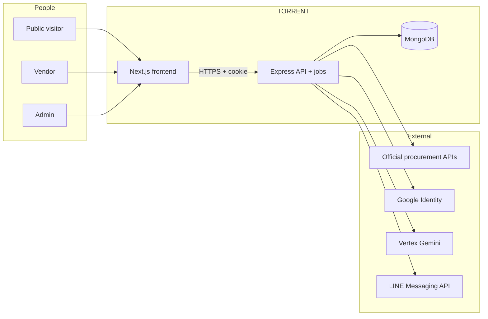
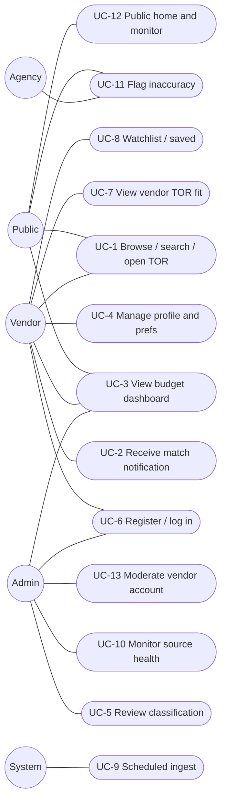
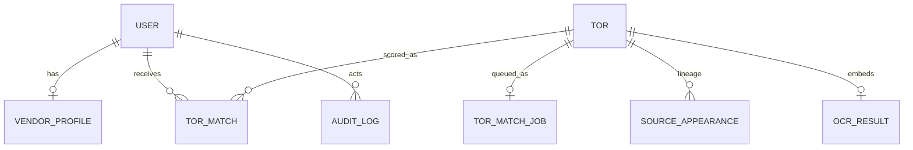
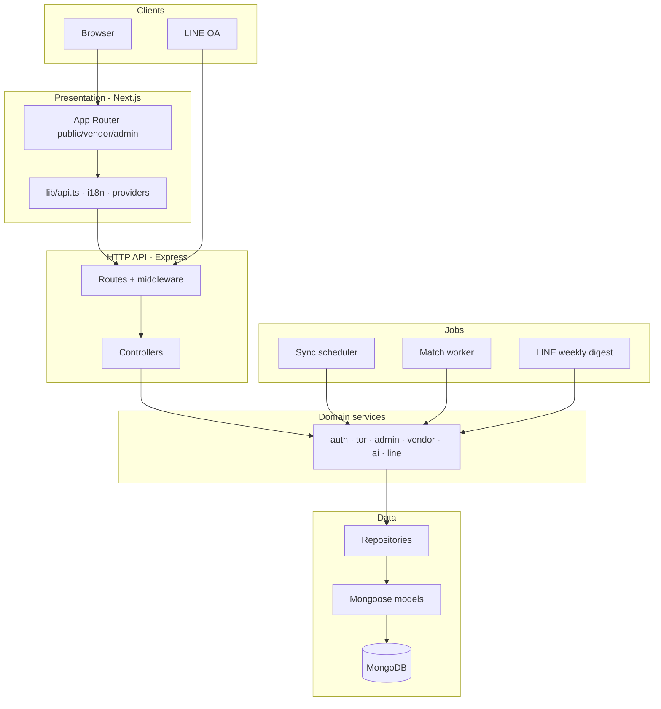
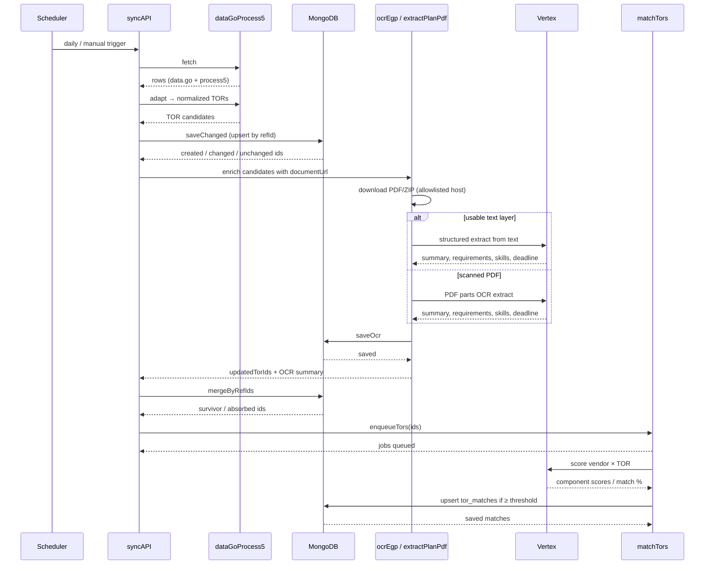
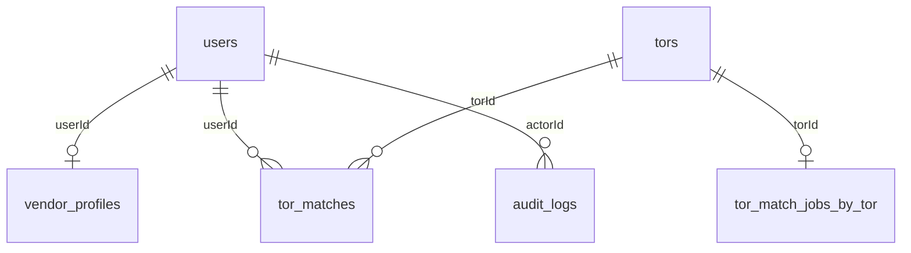
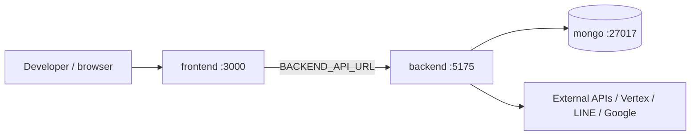

# Software Design Document (SDD)

**Product:** TORRENT — Software TOR Monitor  
**Document type:** Internal design (for developers)  
**Version:** 1.0  
**Date:** 9 November 2026  
**Status:** Draft aligned to current codebase  
**Related requirements:** `x-docs/srs.md`

---

## Document index

1. [Introduction](#1-introduction)  
2. [System overview](#2-system-overview)  
3. [Use case model](#3-use-case-model) *(added)*  
4. [Domain model](#4-domain-model) *(added)*  
5. [Architectural design](#5-architectural-design)  
6. [Layer design](#6-layer-design) *(added; replaces UML class diagram)*  
7. [Detailed design](#7-detailed-design)  
8. [API design](#8-api-design) *(added)*  
9. [Database design](#9-database-design)  
10. [External interfaces](#10-external-interfaces)  
11. [Security considerations](#11-security-considerations)  
12. [Performance and scalability](#12-performance-and-scalability)  
13. [Deployment architecture](#13-deployment-architecture)  
14. [Testing strategy](#14-testing-strategy)  
15. [Appendices](#15-appendices)  
&nbsp;&nbsp;15.1 How to read the code · 15.2 How to run · 15.3 System screenshots  

**Intentionally omitted / deferred**

| Template item | Status |
| --- | --- |
| UML class diagram | Omitted — backend is layered modules, not OOP-heavy classes. See §6 Layer design. |
| Hardware interfaces | N/A |
| Full production CI/CD & cloud topology | Partial — local Compose known; production hosting still evolving |
| Formal threat-model Mermaid | Deferred — OWASP ASVS tracking exists in `x-docs/OWASP_ASVS_Torrent_filled.csv` |
| Migration strategy (SQL-style) | N/A — MongoDB document model; field migrations are ad-hoc scripts when needed |

---

## 1. Introduction

### 1.1 Purpose

This Software Design Document defines the **internal design** of TORRENT so other developers can understand how the system is structured, how components interact, how data is stored, and how major pipelines (ingestion, TOR extraction, matching) work.

It translates the SRS into implementable structure. Requirements authority remains `x-docs/srs.md`.

### 1.2 Scope

**In scope**

- Public monitor and budget dashboard for software-related government TORs  
- Vendor accounts, capability profiles, matching, and notifications (LINE)  
- Admin review, sync triggers, and source/ops visibility  
- Scheduled ingestion from official APIs (no HTML scrape as primary ingress)  
- TOR PDF extraction (text layer / Vertex) and vendor–TOR scoring (Vertex)  
- Frontend (Next.js), backend (Express), MongoDB, and in-process jobs  

**Out of scope (v1 design)**

- Submitting bids or collecting bid prices on TORRENT  
- Replacing e-GP as system of record  
- Microservices / service mesh  
- Playwright / HTML scraping of agency websites as ingestion  

### 1.3 Definitions and acronyms

| Term | Definition |
| --- | --- |
| TOR | Terms of Reference / procurement package for a project |
| refId | Stable external identifier used for upserts (e.g. e-GP project id) |
| e-GP | Thai electronic government procurement |
| process5 | e-GP surface used to verify project details and document links |
| data.go | Open data portal used for discovery of government contracts |
| OCDS | Open Contracting Data Standard |
| Vertex | Google Cloud Vertex AI (Gemini) for extract / classify / match |
| Modular monolith | Single API deployable with internal modules and in-process jobs |
| OCR / extract | Pulling summary, requirements, skills, deadline from a TOR PDF |
| SDD | Software Design Document |
| SRS | Software Requirements Specification |

### 1.4 References

| Document | Location |
| --- | --- |
| SRS | `x-docs/srs.md` |
| Codebase guide | `x-docs/codebase-guide.md` |
| Proposal | `x-docs/project_details/Proposal.md` |
| Layer diagram asset | `x-docs/torrent-layer-diagram.svg` / `.png` |
| ER / DBML | https://dbdiagram.io/d/6a940246aed2f4f6be658c21 |
| ASVS tracking | `x-docs/OWASP_ASVS_Torrent_filled.csv` |
| Runbook | `README.md` |

---

## 2. System overview

### 2.1 System description

TORRENT is a **reversed job board** and **public software-TOR monitor**. It:

1. Ingests official procurement feeds on a schedule  
2. Normalizes and deduplicates into MongoDB `tors`  
3. Extracts requirements from TOR PDFs when available  
4. Classifies / reviews software relevance  
5. Matches vendor profiles via Vertex and stores scores  
6. Exposes public, vendor, and admin UIs over a REST API  

### 2.2 Design goals

| Goal | How it shows up in design |
| --- | --- |
| Maintainability | Layered backend (`routes → controllers → services → repositories → models`); source adapters isolated per feed |
| Traceability | Every TOR keeps source lineage (`source`, `sources[]`, official URLs) |
| Honesty of lifecycle | Do not invent draft state for award-only rows; `discovered` when PDF missing |
| Security of secrets | API keys / Vertex / DB URI only in server env — never in the Next.js client bundle |
| Safe to re-run / restart | Matching can resume after a backend restart instead of starting over; syncing the same TOR again updates the existing row instead of creating a duplicate |
| Fair vendor discovery | Capability fit scoring + optional certificate bonuses; apply stays on official sites |

### 2.3 Architecture summary

**Style:** Modular monolith + scheduled in-process workers.

| Piece | Role |
| --- | --- |
| Next.js frontend | UI for public / vendor / admin |
| Express backend | REST API + sync / OCR / match / LINE digest jobs |
| MongoDB | Persistence |
| External systems | data.go / process5 / BMA / RSS, Google Identity, Vertex, LINE |

Not microservices: jobs share the same process and repositories as the HTTP API.

### 2.4 System context diagram



```
<diagram:system-context>
  Optional polished export of the Mermaid above for course slides / Google Docs.
</diagram:system-context>
```

---

## 3. Use case model

### 3.1 Actors

| Actor | Type | Primary goals |
| --- | --- | --- |
| Public visitor | Person | Browse TORs, monitor, budget dashboard — no login |
| Vendor | Person | Profile, matches, fit reasons, saved items, LINE digest |
| Admin | Person | Sync, classification review, user/TOR moderation |
| Ingestion worker | System | Scheduled / manual sync |
| Matcher worker | System | TOR-centric Vertex matching queue |
| Google / Vertex / LINE / official APIs | Systems | Auth, AI, messaging, data ingress |

### 3.2 Use case catalogue

| ID | Use case | Primary | Summary |
| --- | --- | --- | --- |
| UC-1 | Browse / search / open TOR | Public, Vendor | List, filter, detail; official deep-link |
| UC-2 | Receive match notification | Vendor | Match stored; LINE/digest when enabled |
| UC-3 | View budget dashboard | Anyone | Medians, compare, historical table |
| UC-4 | Manage profile & prefs | Vendor | Capabilities, certificates, digest prefs |
| UC-5 | Review classification | Admin | Approve / reject / hide + audit |
| UC-6 | Register / log in | Vendor, Admin | Google ID token → HTTP-only session |
| UC-7 | View vendor TOR fit | Vendor | Score, reasons, gaps |
| UC-8 | Watchlist / saved | Vendor | Save TOR interest |
| UC-9 | Scheduled ingest | System | Fetch → adapt → upsert → OCR → merge → enqueue match |
| UC-10 | Monitor source health | Admin | Probe / sync visibility |
| UC-11 | Flag inaccuracy | Public / Agency | Report bad data → admin |
| UC-12 | Public home & monitor | Public | Landing + KPIs + latest |
| UC-13 | Moderate vendor account | Admin | Disable / certificate review |



```
<diagram:use-case-model>
  Export the Mermaid above (or redraw in UML style) for Google Docs / slides.
</diagram:use-case-model>
```

### 3.3 UC-9 happy path (ingest)

1. Cron at **00:00 Asia/Bangkok** (optional startup fetch via `FETCH_ON_STARTUP`)  
2. Active source `dataGoProcess5` fetches and adapts rows  
3. Upsert by `refId`  
4. OCR enrich for downloadable TOR PDFs  
5. Cross-source merge  
6. Enqueue match jobs  
7. Score new rows for review thresholds when configured  

---

## 4. Domain model

### 4.1 Core concepts

| Concept | Meaning |
| --- | --- |
| TOR | Normalized opportunity document shown in UI |
| refId | External stable id; sync upsert key |
| Source appearance | One feed’s view of a project (`sources[]` after merge) |
| OCR result | Embedded extraction payload on the TOR |
| Vendor profile | Capabilities used for matching |
| TOR match | Stored score for `(userId, torId)` |
| Match job | Durable queue row per TOR |
| Audit log | Human ops trail |
| Admin settings | Keyword / threshold config for classification |

### 4.2 Conceptual relationships



### 4.3 Logical bounded contexts (same deployable)

| Context | Owns |
| --- | --- |
| Ingestion | Fetchers, adapters, sync, merge |
| Extraction | PDF download, text/OCR, Vertex extract |
| Review / admin | Classification, hide, audit, settings |
| Matching | Queue, Vertex match, thresholds |
| Identity | Google verify, JWT cookie, roles |
| Vendor | Profiles, certificate files |
| Presentation | Next.js + `lib/api.ts` mapping |
| Messaging | LINE link + weekly digest |

---

## 5. Architectural design

### 5.1 System architecture diagram



```
<diagram:system-architecture>
  Prefer also the existing layer PNG: x-docs/torrent-layer-diagram.png
</diagram:system-architecture>
```

### 5.2 Component breakdown

| Component | Responsibilities | Interactions |
| --- | --- | --- |
| Next.js app | Render pages; call REST; session provider; bilingual UI | Express `/api/*` |
| Express HTTP layer | AuthZ, validation glue, JSON/multipart responses | Services |
| TOR / sync services | Ingest, normalize, OCR, merge, CRUD | Repositories, external APIs, Vertex |
| Matching services / job | Score vendors vs TOR; durable queue | Vertex, `tor_matches`, jobs collection |
| Auth service | Verify Google token; issue cookie JWT | Google, `users` |
| Vendor service | Profile + certificate storage | `vendor_profiles`, `upload/` |
| Admin service | Review queue, settings, audit, bulk TOR ops | Mongo collections |
| LINE service | Webhook, link codes, weekly digest | LINE API, users, matches |
| MongoDB | Persist all domain collections | Repositories |

### 5.3 Technology stack

| Layer | Choice |
| --- | --- |
| Frontend | Next.js 16, React 19, TypeScript, Tailwind |
| Backend | Node.js, Express 5, Mongoose |
| Database | MongoDB 8 |
| AI | Vertex AI Gemini |
| Auth | Google Identity + HTTP-only JWT cookie |
| Messaging | LINE Messaging API |
| Local runtime | Docker Compose (frontend, backend, mongo) |

### 5.4 Data flow and control flow

**Primary ingest + extract + match**



```
<diagram:sequence-tor-extraction>
  Course deliverable sequence (Uchula): polish the Mermaid above.
  Notes:
  - Only https://*.gprocurement.go.th document URLs
  - ZIP prefers tor_*.pdf over Attach_TOR scans
  - OCR_ENABLED / OCR_MAX_PER_SYNC / SUMMARY_VERSION control behavior
</diagram:sequence-tor-extraction>
```

**Auth**

```text
GoogleButton → POST /api/auth/google → verify ID token → User upsert → Set-Cookie → GET /api/auth/me
```

---

## 6. Layer design

UML class diagrams are **not** used. Backend structure is expressed as layers (Sandee). Existing asset: `x-docs/torrent-layer-diagram.svg`.

| Layer | Location | Rule |
| --- | --- | --- |
| L1 Clients | Browser, vendor workspace, admin, LINE | HTTPS only into FE/API |
| L2 Presentation | `frontend/` | No source-specific parsing; map via `lib/api.ts` |
| L3 HTTP API | `backend/src/routes`, `controllers`, `middleware` | Controllers call services only |
| L4 Domain services | `backend/src/services/*` | Own workflows |
| L5 Jobs | `backend/src/jobs`, `scheduler` | Sync 00:00 BKK; match queue; LINE Monday digest |
| L6 Data access | `repositories`, `models` | All DB queries in repositories |
| L7 Persistence | MongoDB | Collections listed in §9 |

```
<diagram:layer-diagram>
  Insert x-docs/torrent-layer-diagram.png here for the printed/Google Docs pack.
</diagram:layer-diagram>
```

---

## 7. Detailed design

Each component uses the same **Aspect | Detail** table. API paths are summarized in §8; schemas in §9.

### 7.1 Frontend (Next.js)

| Aspect | Detail |
| --- | --- |
| Responsibility | Public monitor/dashboard, vendor workspace, admin UI, i18n, session |
| Key modules | `app/(public)`, `(auth)`, `(vendor)`, `(admin)`; `lib/api.ts`; `types/tor.ts`; providers |
| Interfaces | Express via `api()` / `apiUrl()` with `credentials: "include"` |
| Data / state | UI `Tor` mapped from backend; providers for session, locale, saved, notifications, audience; TanStack Query where used |
| Notes | Route-group folders `(…)` do not appear in URLs |

### 7.2 HTTP API / controllers

| Aspect | Detail |
| --- | --- |
| Responsibility | Parse HTTP, enforce auth/role, call services, map errors to status codes |
| Key modules | `routes/*`, `controllers/*`, `middleware/requireAuth.js`, `requireRole.js` |
| Inputs | JSON, query/params, multipart (`profile` + certificate files), cookies |
| Outputs | JSON; protected certificate binaries; LINE webhook ACK `200` fast |
| Errors / state | Exceptions → `4xx/5xx` + `{ message }` (optional `code`); HTTP is stateless; identity in signed cookie |

### 7.3 Ingestion & TOR services

| Aspect | Detail |
| --- | --- |
| Responsibility | Fetch feeds, normalize TOR, upsert, merge duplicates, trigger OCR/match |
| Key modules | `jobs/syncAPI.js`, `services/tor/api/<source>/{fetch,adapter}.js`, `mergeDuplicateTors.js` |
| Sources | Active default: `dataGoProcess5`. Manual: `process3Process5`, `dataGo`, `bmaEgp2`, `egpRss`, … |
| Logic | Adapter → common shape; upsert by `refId` (create / change / unchanged); merge records conflicts |
| Notes | Keyword category helpers live in shared TOR utils |

### 7.4 Extraction (OCR) module

| Aspect | Detail |
| --- | --- |
| Responsibility | Download TOR PDF/ZIP; extract summary, requirements, skills, deadline |
| Key modules | `ocrEgp.js`, `ocrBmaPlans.js`, `extractPlanPdf.js`, `readPdfText.js` |
| Inputs / outputs | In: `documentUrl` on candidates. Out: embedded `tor.ocr` (see §9) |
| Logic | Text layer → Vertex structured JSON; else PDF inline OCR |
| State / caps | `ocr.status`, `summaryVersion`; re-run on URL/version change; `OCR_MAX_PER_SYNC` |
| Notes | `requirementItems` categories: `technical` · `delivery` · `compliance` · `team` · `other` |

### 7.5 Matching module

| Aspect | Detail |
| --- | --- |
| Responsibility | TOR-centric queue; score vendors; persist matches above threshold |
| Key modules | `jobs/matchTors.js`, `matchWithVertex.js`, `TorMatchJob` model |
| Score policy | 30 budget-fit + 70 requirements-fit; certificate bonuses capped; final ≤ 100; keep if ≥ `VERTEX_MATCH_MIN_PERCENT` |
| State | Job `pending` · `running` · `waiting` · `complete` with cursor, lease, `retryAt` |
| Errors | Vertex quota/rate limit → `waiting` + retry; cursor preserved across restarts |

### 7.6 Auth & identity

| Aspect | Detail |
| --- | --- |
| Responsibility | Google login, session cookie, `/me`, logout |
| Key modules | `authService`, `googleAuth`, `session`, `requireAuth`, `requireRole` |
| Roles | `public` · `vendor` · `admin` |
| State | JWT in HTTP-only cookie; `users` row (optional LINE link fields) |

### 7.7 Vendor profiles & certificates

| Aspect | Detail |
| --- | --- |
| Responsibility | Profile CRUD; store relative PNG paths; serve files to owner/admin |
| Key modules | `vendorProfileService`, `certificateStorage`, `certificateUpload` middleware |
| Inputs | JSON or multipart: `securityCertificates` · `aiCertificates` · `otherCertificates` |
| Validation | PNG-only; size/dimension caps; ≤ 5 images per category |
| Storage | `backend/upload/` (Compose bind-mount) |

### 7.8 Admin & review

| Aspect | Detail |
| --- | --- |
| Responsibility | Overview, review queue, rescore, TOR edits/PDF, users, certificates, settings, audit, match retry |
| Key modules | `adminService`, `/api/admin/*` routers |
| Auth | Admin role required |
| Notes | Endpoint list in §8 |

### 7.9 LINE messaging

| Aspect | Detail |
| --- | --- |
| Responsibility | Webhook, account link/unlink, digest preference, weekly digest job |
| Key modules | `line` routes/controllers/services, `lineWeeklyDigest` job |
| Security | HMAC `x-line-signature` over raw body before handling events |

---

## 8. API design

### 8.1 Conventions

| Topic | Rule |
| --- | --- |
| Style | REST + JSON (multipart for certificates) |
| Base | `http://localhost:5175/api` (Compose SSR uses `http://backend:5175/api`) |
| Auth | HTTP-only JWT cookie; CORS allowlist via `CORS_ORIGIN` |
| Client | `frontend/src/lib/api.ts` |
| Caching | Listings/dashboard often `cache: "no-store"` |

### 8.2 Endpoint groups

| Prefix | Auth | Purpose |
| --- | --- | --- |
| `/api/auth` | mixed | Google login, me, logout |
| `/api/tors` | public read; admin write | TOR list/detail + dashboard aggregates |
| `/api/tor-matches` | vendor for `/mine` | Matches CRUD / ensure / pending |
| `/api/vendor-profiles` | owner/admin for mutating | Profiles + certificates |
| `/api/sync/*` | admin | Manual / full sync and OCR triggers |
| `/api/admin/*` | admin | Ops, review, settings, audit |
| `/api/line` | webhook HMAC; vendor/admin for link APIs | LINE integration |
| `/api/users`, `/api/user-bios` | as routed | Account / bio helpers |
| `/`, `/api/hello` | public | Liveness |

### 8.3 Representative contracts

| Name | Method / path | Auth | Input | Output |
| --- | --- | --- | --- | --- |
| Google login | `POST /api/auth/google` | — | Google credential / ID token | HTTP-only session cookie + user payload |
| Vendor matches | `GET /api/tor-matches/mine` | vendor (cookie) | session cookie | Match rows (`matchPercent`, `matchReason`, `torId`, …) |
| Sync (admin) | `POST /api/sync/data-go-process5` | admin | — (trigger only) | Sync summary: fetched / created / updated, OCR counts, errors |

---

## 9. Database design

### 9.1 ER / schema diagram

Live DBML (Sandee): https://dbdiagram.io/d/6a940246aed2f4f6be658c21  

MongoDB does not enforce foreign keys; refs are logical.



```
<diagram:er-diagram>
  Embed dbdiagram.io export / screenshot.
</diagram:er-diagram>
```

### 9.2 Collections

| Collection | Model | Purpose / key fields |
| --- | --- | --- |
| `users` | `User.js` | email (unique), role, googleId, lineUserId, disabled |
| `vendor_profiles` | `VendorProfile.js` | userId (unique), skills, pastProjects, certificate path arrays |
| `tors` | `TOR.js` | refId, title*, status, source, budget/dates, review*, integrity*, sources[], merge*, ocr{} |
| `tor_matches` | `TORMatch.js` | unique `(userId, torId)`, matchPercent, matchReason, dismissedAt |
| `tor_match_jobs_by_tor` | `TorMatchJob.js` | unique torId, status, cursor, lease, retry |
| `audit_logs` | `AuditLog.js` | action, targetType/Id, actor*, changes[] |
| `sync_runs` | `SyncRun.js` | sourceKey, status, run metrics |
| `admin_settings` | `AdminSettings.js` | keyword rules, thresholds |
| `userbios` | `UserBio.js` | public bio (if used) |

### 9.3 Relationships

MongoDB does not enforce foreign keys; these are logical links via ObjectId / embeds.

| From | To | Cardinality | How linked | Notes |
| --- | --- | --- | --- | --- |
| User | VendorProfile | 1 → 0..1 | `vendor_profiles.userId` | One profile per user |
| User | TORMatch | 1 → 0..\* | `tor_matches.userId` | Vendor’s match inbox |
| TOR | TORMatch | 1 → 0..\* | `tor_matches.torId` | Scores for that TOR |
| User + TOR | TORMatch | — | unique `(userId, torId)` | At most one match row per pair |
| TOR | TorMatchJob | 1 → 0..1 | `tor_match_jobs_by_tor.torId` | Durable queue row per TOR |
| User | AuditLog | 1 → 0..\* | `audit_logs.actorId` | Soft link; actor may be null |
| TOR | OCR result | 1 → 0..1 | embedded `tors.ocr` | Not a separate collection |
| TOR | Source appearances | 1 → 0..\* | embedded `tors.sources[]` | Multi-feed lineage after merge |

### 9.4 Indexes (selected)

| Collection | Index | Kind | Why |
| --- | --- | --- | --- |
| `users` | `email` | unique | Login / account lookup |
| `users` | `googleId` | unique, sparse | Google identity |
| `users` | `lineUserId` | unique, sparse | LINE link |
| `vendor_profiles` | `userId` | unique | 1:1 with user |
| `tors` | `refId` | indexed | Sync upsert / dedupe |
| `tors` | `hidden`, `reviewStatus`, `integrityStatus`, `mergeStatus` | indexed | List / admin filters |
| `tor_matches` | `(userId, torId)` | unique compound | One score per vendor–TOR pair |
| `tor_match_jobs_by_tor` | `torId` | unique | One job per TOR |
| `tor_match_jobs_by_tor` | `status` | indexed | Worker dequeue |
| `audit_logs` | `createdAt` | descending | Recent audit trail |
| `audit_logs` | `action`, `targetType`, `targetId` | indexed | Filter by event / target |

### 9.5 Migration strategy

No SQL migration tool. Schema evolves with Mongoose models; occasional one-off scripts under `backend/src/utils` (e.g. vendor field migration). Upserts make re-sync safe for TOR rows.

---

## 10. External interfaces

### 10.1 User interface

| Surface | Notes |
| --- | --- |
| Public | Home, monitor, TOR browse/detail, budget dashboard — no login |
| Vendor `/app/*` | Overview, matches, TORs, profile, alerts |
| Admin | Source health, review queue, TOR/user moderation |
| Locale | EN / TH dictionary-driven copy |
| Bid action | Always outbound to official e-GP / listing URL |

Mockups/wireframes: see proposal / frontend; not duplicated here.

### 10.2 External APIs / integrations

| Integration | Direction | Use |
| --- | --- | --- |
| data.go + process5 | Out | Primary discovery + document verification |
| BMA e-GP2 | Out | Manual/alternate city source + plans OCR |
| e-GP RSS / process3 path | Out | Manual alternate draft/announce path |
| Google Identity | Out | ID token verification |
| Vertex Gemini | Out | Extract, score/match, assist review |
| LINE Messaging | In/Out | Webhook + push digest |

### 10.3 Hardware interfaces

Not applicable.

### 10.4 Network protocols / communication

- **Browser ↔ API:** HTTPS (local HTTP), REST JSON, cookie session  
- **Workers ↔ government APIs:** HTTPS GET/POST as per source  
- **LINE webhook:** HTTPS POST + HMAC signature  
- **Not used:** GraphQL, gRPC, WebSockets (current design)

---

## 11. Security considerations

### 11.1 Authentication

- Google ID token verified server-side  
- Session = signed JWT in **HTTP-only** cookie  
- LINE webhook authenticated via channel secret HMAC  

### 11.2 Authorization

- Roles: `public`, `vendor`, `admin`  
- Middleware: `requireAuth`, `requireRole`, profile ownership checks  
- Certificate download restricted to owner/admin  
- Sync and admin routers require admin  

### 11.3 Data protection

- Secrets only in environment variables  
- CORS origin allowlist + credentials  
- Certificate uploads: PNG-only validation (signature, chunks, size, dimensions)  
- OCR download host allowlist (`*.gprocurement.go.th`, HTTPS)  
- Mongoose parameterized queries (no string-concat query building)  
- Vendor capability detail private except intentionally public showcase fields  

### 11.4 Compliance

- No HIPAA scope  
- Personal data: Google profile fields, vendor contact, LINE user id — minimize retention; treat as student/course system with secure defaults  
- Security requirements tracked against OWASP ASVS (team checklist)  

### 11.5 Threat notes (lightweight)

| Threat | Mitigation |
| --- | --- |
| SSRF via document URL | Host/protocol allowlist on OCR fetch |
| Session theft | HTTP-only cookie; HTTPS in deploy |
| Injection | Mongoose APIs; no eval of TOR text as code (prompt treats TOR as data) |
| Upload abuse | PNG validation + size/count caps |
| LINE spoofing | Signature verification on raw body |

---

## 12. Performance and scalability

### 12.1 Expected load

Course / prototype scale: low concurrent users; ingestion bounded by:

- Source page size / retries in constants  
- `EGP_MAX_PROJECTS_PER_SYNC` (and similar caps)  
- `OCR_MAX_PER_SYNC`  
- Vertex rate limits (match jobs wait/retry)  

Exact RPS targets are **not** fixed yet.

### 12.2 Caching strategy

- No shared Redis cache in current design  
- Next.js: intentional `no-store` on TOR dashboard/list fetches so sync is visible  
- Browser/providers may keep saved TOR ids / prefs in `localStorage`  

### 12.3 Database optimization

- Indexes on refId, review/integrity/merge flags, match pair uniqueness, job status  
- Upsert-by-refId avoids duplicate growth  
- OCR skip when same `fileUrl` + `summaryVersion` already `ok`  

### 12.4 Scaling strategy

| Near term | Later if needed |
| --- | --- |
| Vertical scale single API + MongoDB Atlas tier | Split OCR/match worker process |
| Cap work per sync | Horizontal workers with leased jobs (lease fields already exist) |

---

## 13. Deployment architecture

### 13.1 Environments

| Environment | How |
| --- | --- |
| Local npm | Frontend `:3000`, backend `:5175`, local or Compose Mongo |
| Local Compose | `docker-compose.yml` — frontend, backend, mongo:8, volume `mongo_data` |
| Production | Evolving (proposal mentioned Vercel for FE; API/worker separate). **Details TBD.** |

### 13.2 CI/CD pipeline

Current repo CI: GitHub Actions ESLint workflow (`.github/workflows/eslint.yml`).  
Full deploy pipeline (build → staging → prod) is **not fully specified** in-repo yet.

### 13.3 Infrastructure diagram (local Compose)



```
<diagram:deployment>
  Add production hosting diagram when environments are frozen.
</diagram:deployment>
```

### 13.4 Cloud / hosting

- AI: **GCP Vertex**  
- DB: MongoDB local or Atlas  
- Frontend hosting candidate: Vercel (proposal)  
- Backend/worker: container or VM — finalize with team  

### 13.5 Containerization

- Dockerfiles for frontend/backend; Compose orchestration  
- Bind mounts for live code; anonymous volumes for `node_modules`  
- Backend upload directory preserved via host bind in Compose workflow  

---

## 14. Testing strategy

### 14.1 Unit / module tests

Backend Node test files under `backend/tests/`, including:

- sync / dataGoProcess5 / process3Process5  
- OCR extract  
- merge duplicates  
- match / Vertex scoring helpers  
- certificate uploads  
- admin / category / budget aggregates  

Run examples are documented in README for certificate tests; other suites via Node test runner with module-alias as used in-repo.

### 14.2 Integration testing

- Certificate upload tests mock DB and use temp upload dir  
- Sync/OCR tests exercise adapters and persistence paths with fixtures/mocks as implemented  

### 14.3 End-to-end testing

No dedicated E2E framework locked in this document yet (Playwright for product UI is optional later). Manual Compose smoke: FE load, `/api/hello`, admin sync, vendor login.

### 14.4 Quality metrics

- ESLint on CI for frontend/workflow as configured  
- Formal coverage % target: **not mandated yet**  
- Prefer tests around money parsing, merge conflicts, OCR normalization, and match threshold math — high-regression areas  

---

## 15. Appendices

### 15.1 How to read the code (onboarding)

Read in this order:

1. `docker-compose.yml`  
2. `backend/src/server.js`, `app.js`  
3. `backend/src/jobs/syncAPI.js`  
4. `backend/src/services/tor/ocr/*`  
5. `backend/src/jobs/matchTors.js`  
6. `frontend/src/lib/api.ts`  
7. `frontend/src/app/(public)/dashboard` and `(vendor)/app/*`  

For a fuller file-level map, see the project codebase guide in the repo docs.

### 15.2 How to run the project

**Prerequisites:** Docker Desktop (or Docker Engine + Compose v2.30+). Host Node/Mongo are optional if you use Compose only.

#### First time

1. Clone the repo and open a terminal at the repository root.  
2. Create env from the example and fill real values (JWT, Mongo, API keys, etc.):

```bash
cp backend/.env.example backend/.env
```

3. For Compose Mongo, set in `backend/.env`:

```dotenv
PORT=5175
MONGO_URI=mongodb://mongo:27017/csp_project
```

(`mongo` is the Compose service name — not `localhost` inside the container.)

4. Prepare Docker secrets and start the stack:

```bash
./process.sh
```

5. Open:  
   - Frontend: http://localhost:3000  
   - Backend: http://localhost:5175 (`GET /api/hello` for a quick check)  

6. Optional: follow logs with `docker compose logs -f`.

#### Next time (already configured)

| Goal | Command |
| --- | --- |
| Start / rebuild full stack (also refreshes secrets from `.env`) | `./process.sh` |
| Refresh secrets only (no restart) | `./process.sh secrets` |
| Recreate backend only after `.env` change | `./process.sh up backend` |
| Stop stack (keep DB volume) | `docker compose down` |
| Stop and wipe local DB volume | `docker compose down -v` |

After `.env` edits that affect secrets, prefer `./process.sh` or `./process.sh up backend` so `backend/.secrets/` stays in sync.

### 15.3 System screenshots

Paste UI captures into Google Docs under each slot (or replace the tags with images). Keep captions short.

| # | Screen | Audience | What to show |
| --- | --- | --- | --- |
| 1 | Home / landing | Public | Brand, value prop, entry to monitor / listings |
| 2 | Public monitor | Public | KPIs, latest listings, integrity highlights |
| 3 | TOR browse / list | Public, Vendor | Filters + listing cards |
| 4 | TOR detail | Public, Vendor | Summary, requirements, official link, integrity |
| 5 | Budget dashboard | Public, Vendor | Category medians / compare charts |
| 6 | Vendor matches | Vendor | Match % + reasons inbox |
| 7 | Vendor profile | Vendor | Capabilities / certificates form |
| 8 | Admin review | Admin | Classification queue / TOR review |

```
<screenshot:home>
<screenshot:monitor>
<screenshot:tor-list>
<screenshot:tor-detail>
<screenshot:dashboard>
<screenshot:vendor-matches>
<screenshot:vendor-profile>
<screenshot:admin-review>
```
